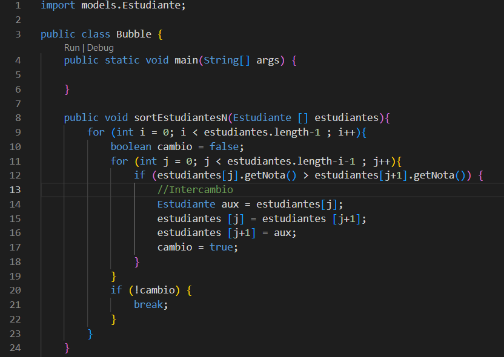
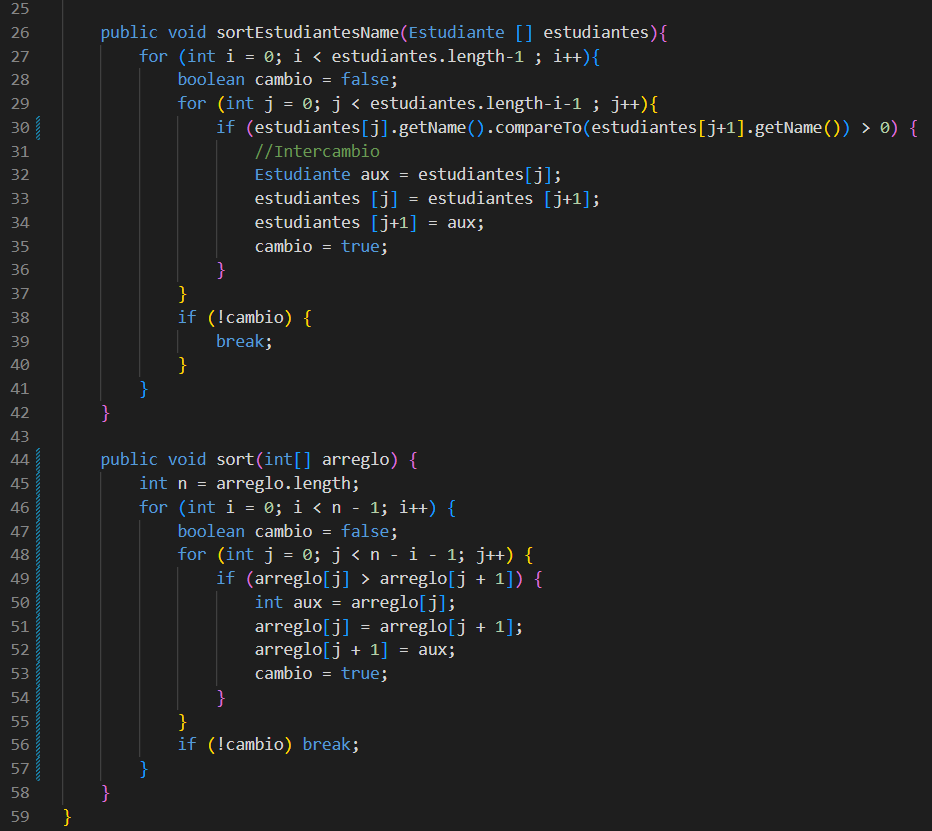
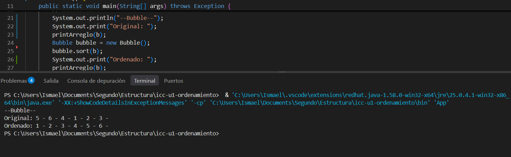

#Autor: Ismael Alejandro Pauta Sotelo
#Evidencia de ordenamiento con Bubble sort:

## 1. Captura del código

## 2. Explicación

El algortimo de Bubble Sort recorre el arreglo comparando elementos de dos en dos. Si el número de la izquierda es mayor que el de la derecha, los intercambia guardandolos en una variable auxiliar. Esto se repite varias veces hasta que todos los elementos quedan ordenados de menor a mayor, logrando que los numeros mas grandes vayan flotando hacia el final del arreglo de manera ordenado.

## 3. Captura de la consola
