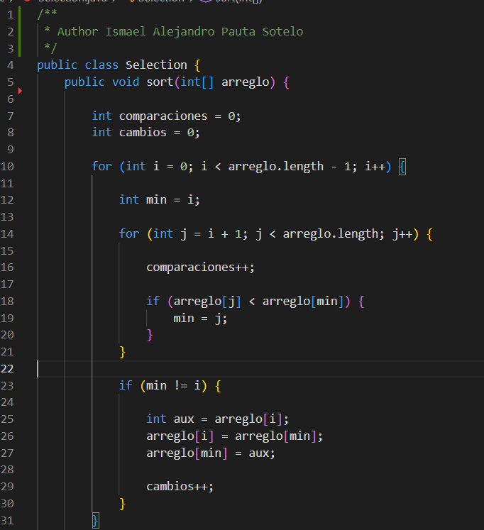
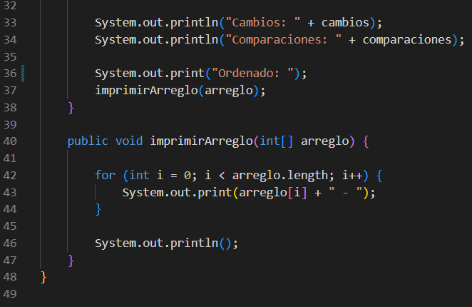
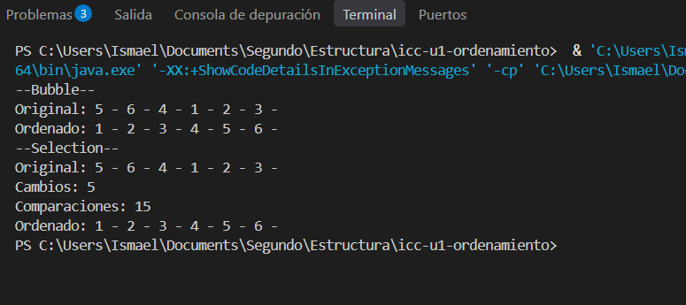

#Autor: Ismael Alejandro Pauta Sotelo
#Evidencia de ordenamiento con Selection sort:

## 1. Captura del código

## 2. Explicación

El algoritmo Selection Sort recorre la lista para bucar el numero mas pequeño de todos. Cuando lo encuentra, lo intercambia y lo coloca al principio en primera posición, avanzando una posicion, hasta que toda la lista queda ordenada de mayor a menor.

## 3. Captura de la consola
