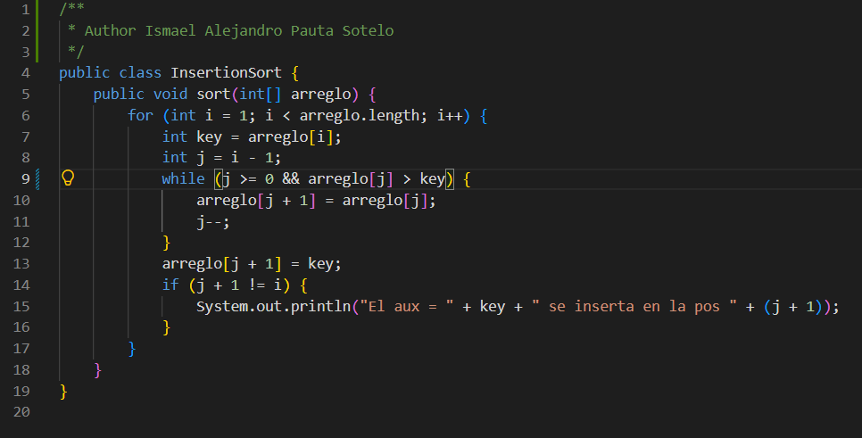
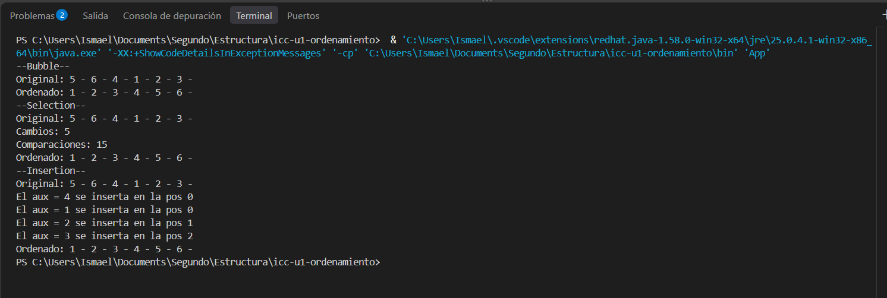

#Autor: Ismael Alejandro Pauta Sotelo
#Evidencia de ordenamiento con Insertion sort:

## 1. Captura del código

## 2. Explicación

El algoritmo Insertion Sort funciona de manera similar a como cuando se ordenan cartas en la mano. Va tomando los elementos uno por uno de la parte desordenada y va comparando con los que estan en la izquierda. A medida que encuentra su lugar correcto, va desplazando los números mayores hacia la derecha para insertar el elemento en la posicion que le corresponde, repitiendo este proceso hasta que queda ordenado de manor a mayor.

## 3. Captura de la consola
